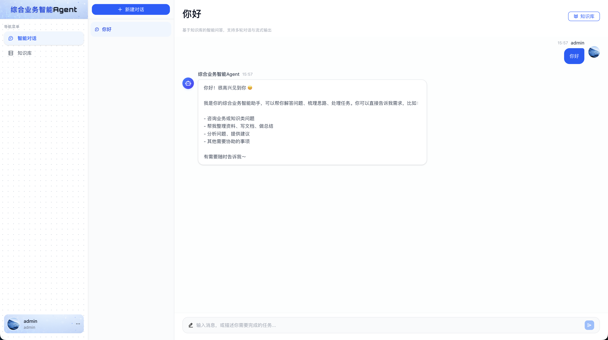
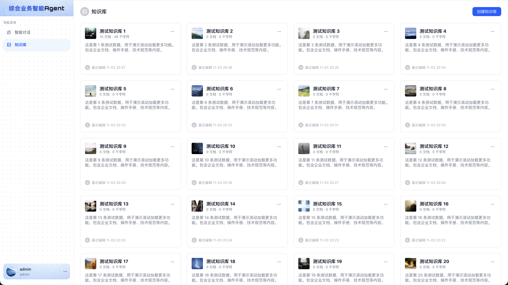

# 综合业务智能 Agent 前端

> 综合业务智能 Agent 前端 Lite 版本，仅保留 智能对话+知识库 模块！

基于 Vue 3 + TypeScript 构建的现代化 AI 对话界面，支持知识库关联、流式输出、多轮对话。

<p align="center">
  
</p>

## ✨ 特性

- **智能对话** — 流式输出，支持多轮对话上下文，可随时停止生成
- **检索方式可选** — 对话页顶部可切换语义 / 全文 / 混合检索，齿轮弹层可调最大召回数量与最小匹配度；三者是全局偏好（localStorage 持久化），切换会话不重置，只对选中的知识库生效
- **知识库关联** — 对话时选择关联知识库，精准问答；选择按会话记忆，切换/刷新后自动恢复
- **知识库管理** — 文档上传、自动切片、向量化索引
- **召回测试** — 支持语义检索、全文检索、混合检索
- **会话管理** — 历史记录持久化，支持重命名/删除
- **账号体系** — 注册/登录，账号设置（昵称/密码/头像）

## 🖼️ 界面预览

|           智能对话           |          知识库管理           |
| :--------------------------: | :---------------------------: |
|  |  |

## 🛠️ 技术栈

| 类别 | 技术                      |
| ---- | ------------------------- |
| 框架 | Vue 3.5 (Composition API) |
| 构建 | Vite 8                    |
| 语言 | TypeScript                |
| 路由 | Vue Router 4              |
| 状态 | Pinia                     |
| UI   | Arco Design Vue           |
| 样式 | Tailwind CSS 4            |
| HTTP | 原生 Fetch + SSE          |

## 📁 项目结构

```
src/
├── components/          # 全局组件
│   ├── BaseModal/       # 基础弹窗
│   └── Layout/          # 布局组件
├── hooks/               # 组合式函数
├── models/              # TypeScript 类型
├── router/              # 路由配置
├── services/            # API 服务
├── stores/              # Pinia 状态
├── styles/              # 全局样式
├── utils/               # 工具函数
└── views/               # 页面
    ├── chat/            # 智能对话
    ├── dataset/         # 知识库管理
    │   ├── documents/   # 文档管理
    │   └── segments/    # 片段管理
    └── login/           # 登录注册
```

## 🚀 快速开始

### 安装依赖

```bash
yarn install
```

### 启动开发服务器

```bash
yarn dev
```

访问 http://localhost:3000

### 构建生产版本

```bash
yarn build
```

## ⚙️ 环境配置

API 代理配置在 `vite.config.ts`：

```typescript
server: {
  port: 3000,
  proxy: {
    '/api': {
      target: 'http://localhost:8000',  // 后端地址
      changeOrigin: true,
    },
  },
}
```

## 📝 开发规范

- **Git 提交** — 遵循 Conventional Commits，提交前自动 lint
- **代码格式** — `yarn lint` 检查，`yarn format` 格式化
- **组件命名** — PascalCase，页面组件放 views 目录

## 📡 API 适配

本项目配合 [nexus-agent](https://github.com/weizxdev/nexus-agent) 后端使用。

## 📄 许可证

MIT
